# Software Forest: A Visualization of Semantic Similarities in Source Code using a Tree Metaphor

Daniel Atzberger, [Tim Cech](https://orcid.org/0000-0001-8688-2419), [Merlin de la Haye](https://orcid.org/0009-0000-9517-4609), [Maximilian Söchting](https://orcid.org/0000-0002-8761-2821), [Willy Scheibel](https://orcid.org/0000-0002-7885-9857), [Daniel Limberger](https://orcid.org/0000-0002-9111-4809), and [Jürgen Döllner](https://orcid.org/0000-0002-8981-8583)

*Proceedings of the 16th International Joint Conference on Computer Vision, Imaging and Computer Graphics Theory and Applications (IVAPP '21)*, February 8–10, 2021, online. SciTePress, pp. 112–122.

DOI: [10.5220/0010267601120122](https://doi.org/10.5220/0010267601120122) · Author's version: [Zenodo](https://doi.org/10.5281/zenodo.24060500) · [ResearchGate](https://www.researchgate.net/publication/349382985)

> Software visualization techniques provide effective means for program comprehension tasks as they allow developers to interactively explore large code bases.
> A frequently encountered task during software development is the detection of source code files of similar semantic.
> To assist this task we present Software Forest, a novel 2.5D software visualization that enables interactive exploration of semantic similarities within a software system, illustrated as a forest.
> The underlying layout results from the analysis of the vocabulary of the software documents using Latent Dirichlet Allocation and Multidimensional Scaling and therefore reflects the semantic similarity between source code files.
> By mapping properties of a software entity, e.g., size metrics or trend data, to visual variables encoded by various, figurative tree meshes, aspects of a software system can be displayed.
> This concept is complemented with implementation details as well as a discussion on applications.

<p><a href="atzberger2021-forest-as-submitted.pdf">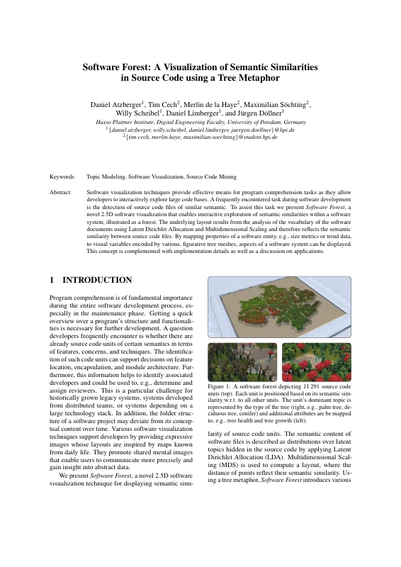</a> <a href="atzberger2021-forest-as-submitted.pdf">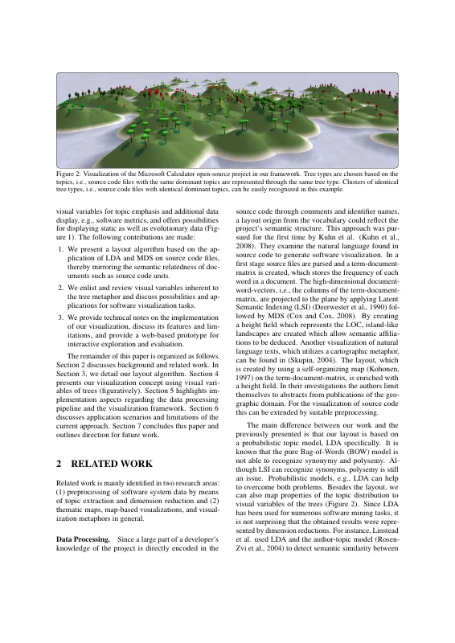</a> <a href="atzberger2021-forest-as-submitted.pdf">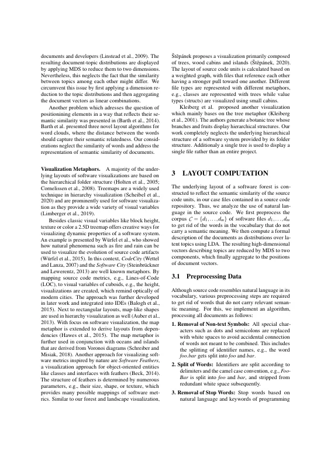</a> <a href="atzberger2021-forest-as-submitted.pdf">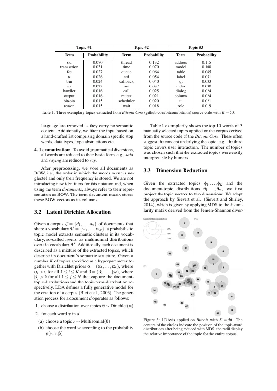</a> <a href="atzberger2021-forest-as-submitted.pdf">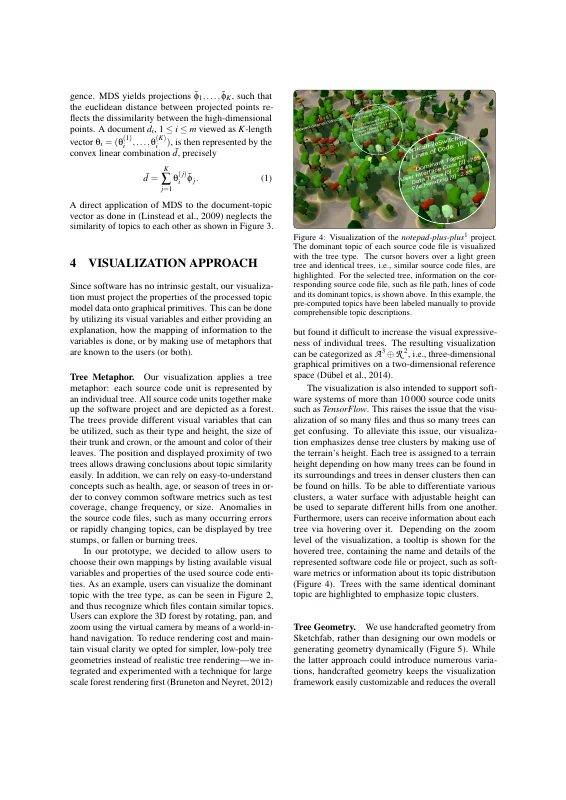</a> <a href="atzberger2021-forest-as-submitted.pdf">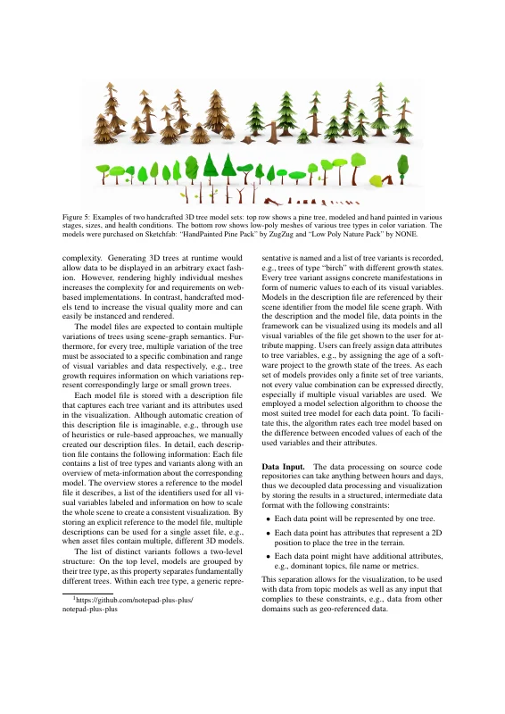</a> <a href="atzberger2021-forest-as-submitted.pdf">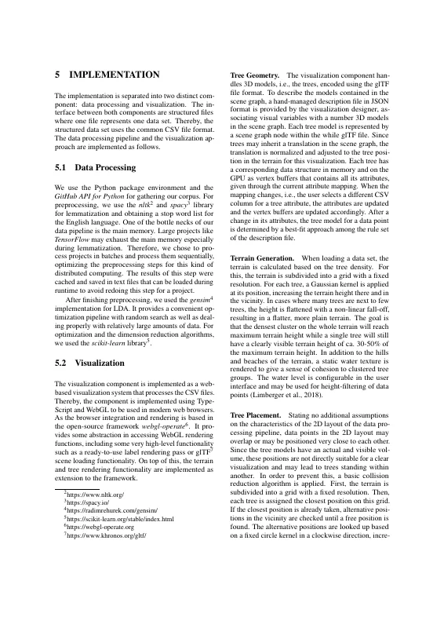</a> <a href="atzberger2021-forest-as-submitted.pdf">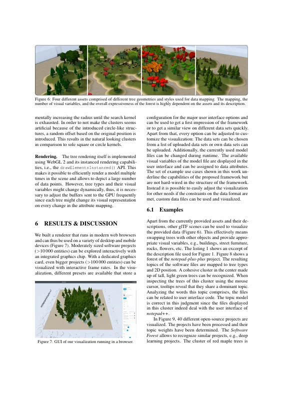</a> <a href="atzberger2021-forest-as-submitted.pdf">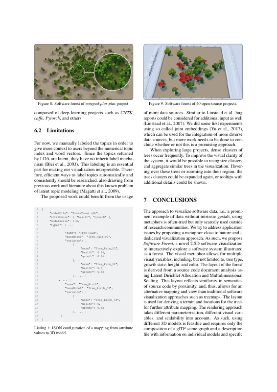</a> <a href="atzberger2021-forest-as-submitted.pdf">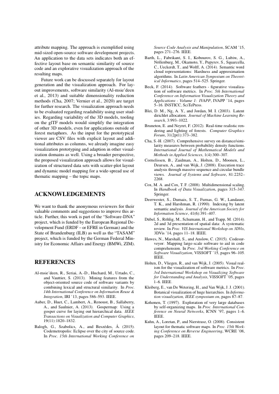</a> <a href="atzberger2021-forest-as-submitted.pdf">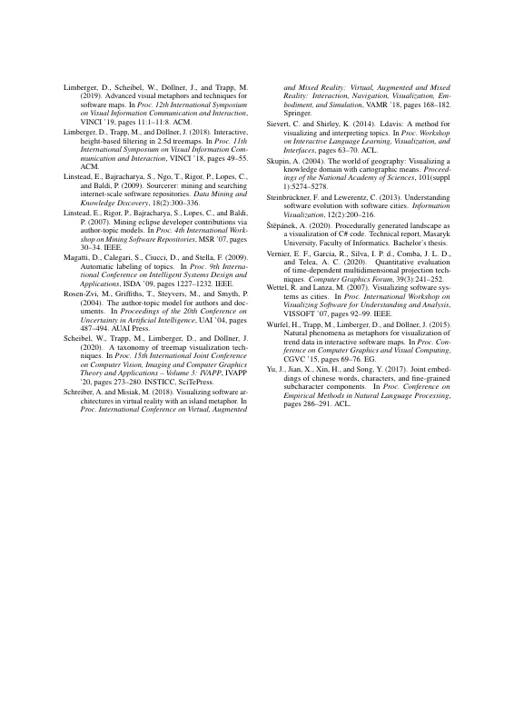</a></p>

## Contents

- [`src/`](src/) – LaTeX sources of the camera-ready version (SciTePress conference template, January 2020)
- [`atzberger2021-forest-as-submitted.pdf`](atzberger2021-forest-as-submitted.pdf) – camera-ready PDF (author build, without the publisher's header/footer)
- [`build.sh`](build.sh) – reproducible build with TeX Live 2019 (podman or docker)
- [`preview/`](preview/) – page previews for this README

## Build

```bash
./build.sh        # → build/main.pdf
```

The SciTePress template files (`article.cls`, `SCITEPRESS.sty`, `apalike.sty`, `apalike.bst`) are bundled in `src/` and take precedence over the TeX Live versions.
`atzberger2021-forest-as-submitted.pdf` was built on Overleaf with TeX Live 2019, hence the TeX Live 2019 container.
On `main`, the build produces the revised version (`v1.1-revised`). Check out `v1.0-camera-ready` to reproduce `atzberger2021-forest-as-submitted.pdf` (identical text and layout; a single glyph on page 6 renders marginally differently).

## Versions

- [`v1.0-camera-ready`](https://github.com/dl-archive/article.2021-ivapp-software-forest/tree/v1.0-camera-ready) – sources as submitted to SciTePress
- [`v1.1-revised`](https://github.com/dl-archive/article.2021-ivapp-software-forest/tree/v1.1-revised) – author's revised version (2026-11-08): grammar and reference fixes, see [Revisions](#revisions)

## Revisions

`v1.1-revised` (2026-11-08) corrects errors in the camera-ready version without changing its content or layout.
Every page carries the note "Author's revised version (2026-11-08). Version of record: https://doi.org/10.5220/0010267601120122".

- Spelling: "addresses", "positioning", "Additionally", "dissimilarity", "Euclidean", "bottlenecks", "whole glTF file", "PyTorch", "Štěpánek".
- Grammar and word choice: "similar semantics", "overview of", "developed by distributed teams", "w.r.t. all other units", "can be mapped to" (Figure 1), "distances of points reflect", "We list", "directions for future work", "a layout derived from", "software visualizations", "visually resemble modern cities", "is mainly based on", "which describes the document's", "a dissimilarity matrix", "programming languages", "domain-specific", "an explanation of how", "by rotation, pan, and zoom", "can then be found", "source code file", "the same dominant topic", "arbitrarily exact", "multiple variations … associated with", "are shown to the user", "allows the visualization to be used", "complies with", "two distinct components", "libraries", "The browser integration and rendering are based on", "extensions", "a number of 3D models", "vertex buffers that contain", "30–50%", "composed of … their descriptions" (Figure 6), "within one another", "seem artificial", "natural-looking clusters", "allows depicting", "underlines", "Listing 1", "allows recognizing", "inherent labeling mechanism", "so-called", "tree clusters", "based on semantic similarity", "targets for further research", "adaptation", and missing commas.
- References: capitalization of Dirichlet, LDAvis, CodeSurveyor, CodeMetropolis, Eclipse, Gosper(Map), 2D/3D, 2.5D, and Chinese in titles; "van Deursen" (Cornelissen et al.); "van de Wetering", "van Wijk", venue and pages 87–94 (Kleiberg et al.); dash in "Software Feathers – Figurative …"; "Štěpánek" (was rendered with breve accents).

ORCIDs were not added to the PDF: the SciTePress `\orcidAuthor` footnotes would reflow the first page.

## Citation

```bibtex
@InProceedings{atzberger2021-forest,
  author    = {Atzberger, Daniel and Cech, Tim and de la Haye, Merlin and S{\"o}chting, Maximilian and Scheibel, Willy and Limberger, Daniel and D{\"o}llner, J{\"u}rgen},
  title     = {Software Forest: A Visualization of Semantic Similarities in Source Code using a Tree Metaphor},
  booktitle = {Proceedings of the 16th International Joint Conference on Computer Vision, Imaging and Computer Graphics Theory and Applications},
  year      = {2021},
  series    = {IVAPP~'21},
  publisher = {SciTePress},
  pages     = {112--122},
  doi       = {10.5220/0010267601120122},
  isbn      = {978-9-897584-88-6},
}
```
